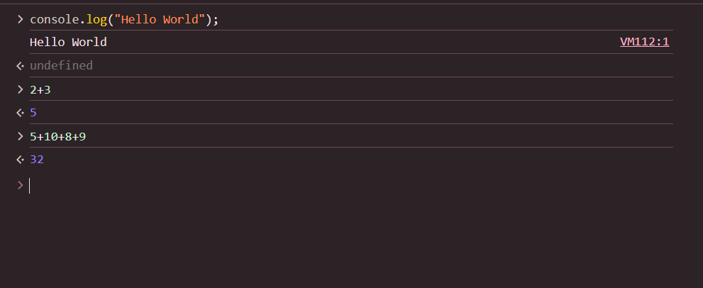

# Browser Console (Developer Tools)

When writing JavaScript, developers need a way to test, debug, and inspect their code. Modern web browsers provide a built-in tool called Developer Tools (DevTools), which includes a powerful feature known as the Console.

The browser console allows developers to:
- Execute JavaScript code directly
- View output from scripts
- Debug errors
- Inspect webpage elements

##  Opening the Browser Console

Most browsers provide multiple ways to open Developer Tools:
- Right-click on a webpage and select **Inspect**
- Press **F12**
- Use shortcut:
  - `Ctrl + Shift + I` (Windows/Linux)
  - `Cmd + Option + I` (Mac)

After opening DevTools, navigate to the **Console** tab.

## Using the Console

The console acts as an interactive JavaScript environment. You can type JavaScript expressions and immediately see the result.

    

        
Snippet Sandbox: Evaluation

    

    <textarea class="sandbox-editor" spellcheck="false"></textarea>
    

        <button class="btn btn-secondary btn-reset">Reset</button>
        <button class="btn btn-primary btn-run">Run Code</button>
    

    
Console empty...

The browser instantly evaluates and displays `5`.

### The REPL Concept

This interactive behavior of console is possible because the browser console operates as a **REPL** environment.

REPL stands for:
- **R** - Read
- **E** - Evaluate
- **P** - Print
- **L** - Loop

It describes the step-by-step process the JavaScript engine follows:
1. **Read**: The console reads the JavaScript expression entered by the user.
2. **Evaluate**: The JavaScript engine executes the expression.
3. **Print**: The result is displayed in the console.
4. **Loop**: The console waits for the next input.

Because of this REPL mechanism, developers can experiment with code in real-time without refreshing the webpage or modifying files.

This makes the console extremely useful for:
- Testing small code snippets
- Understanding JavaScript behavior
- Debugging logic step by step
- Experimenting with new syntax or functions

##  Viewing Errors

If a JavaScript error occurs in your program, the console displays an error message along with:
- The file name
- The line number
- A description of the issue

This helps developers quickly locate and fix problems.

## Why the Console is Important

The browser console is one of the most important tools for any JavaScript developer. It provides immediate feedback, reduces guesswork, and significantly improves debugging efficiency.

# console.log() for Debugging

While the browser console allows interactive testing, JavaScript also provides built-in functions to send output directly to the console. The most commonly used function is `console.log()`.

##  What is console.log()?

`console.log()` is made up of two parts:
- **`console`**: An object provided by the environment (like the browser or Node.js) that gives access to the built-in debugging console.
- **`.log()`**: A method (function) of the `console` object used to print data to the console.

It is primarily used for debugging and inspecting values during program execution.

##  Basic Example

    

        
Snippet Sandbox: Basic Example

    

    <textarea class="sandbox-editor" spellcheck="false"></textarea>
    

        <button class="btn btn-secondary btn-reset">Reset</button>
        <button class="btn btn-primary btn-run">Run Code</button>
    

    
Console empty...

##  Logging Multiple Values

    

        
Snippet Sandbox: Logging Multiple Values

    

    <textarea class="sandbox-editor" spellcheck="false"></textarea>
    

        <button class="btn btn-secondary btn-reset">Reset</button>
        <button class="btn btn-primary btn-run">Run Code</button>
    

    
Console empty...

The console will display both values together.

##  Using console.log() for Debugging

Developers commonly use `console.log()` to:
- Check variable values
- Verify function execution
- Trace program flow
- Identify logical errors

Example:

    

        
Snippet Sandbox: Debugging Functions

    

    <textarea class="sandbox-editor" spellcheck="false"></textarea>
    

        <button class="btn btn-secondary btn-reset">Reset</button>
        <button class="btn btn-primary btn-run">Run Code</button>
    

    
Console empty...

This helps confirm whether the function is being executed.

##  Other Useful Console Methods

Besides `console.log()`, there are additional helpful methods:
- `console.error()` - Displays error messages
- `console.warn()` - Displays warning messages
- `console.table()` - Displays data in table format

## Best Practice

- Use `console.log()` during development.
- Remove unnecessary logs before deploying production code.
- Avoid exposing sensitive data in console output.

## Conclusion

The browser console and `console.log()` function are essential tools for debugging and understanding JavaScript behavior. Mastering them early significantly improves development efficiency and problem-solving skills.
