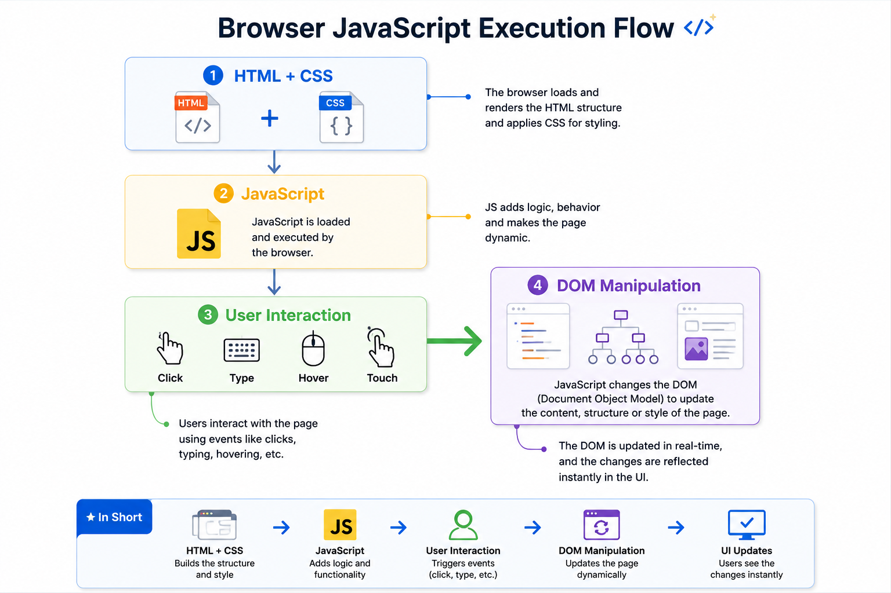
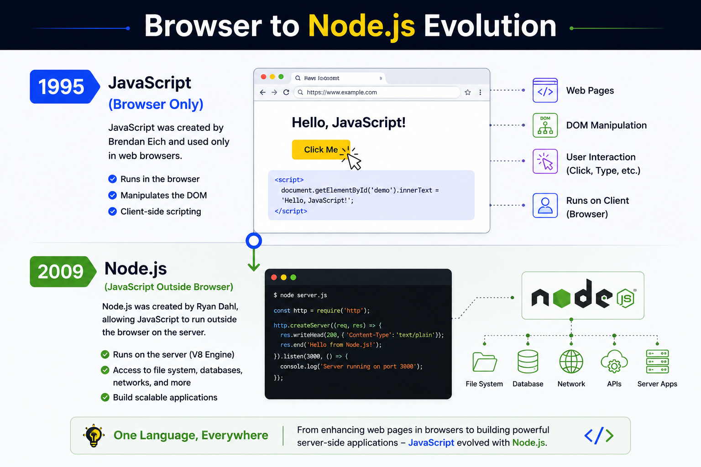
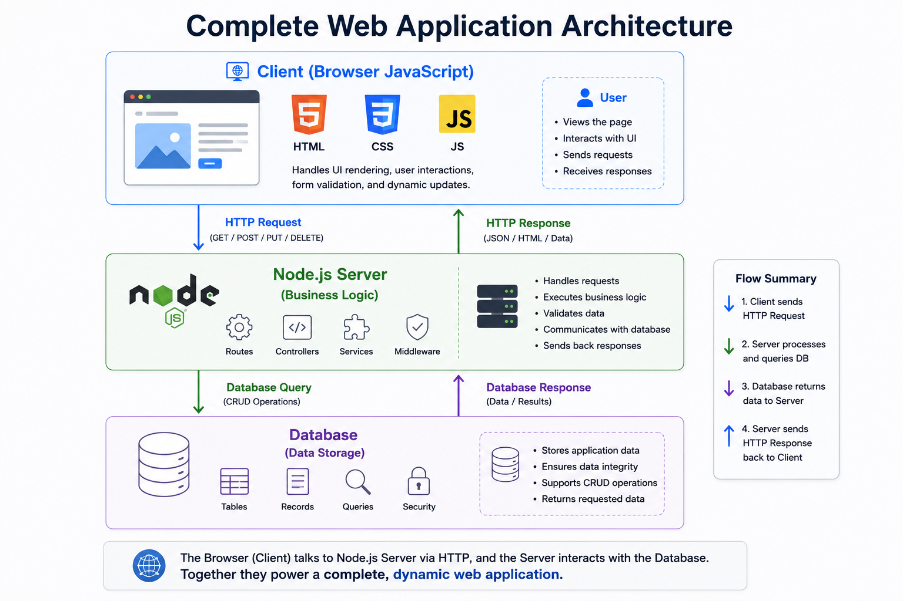

# JavaScript Environments

## Where JavaScript Runs

Before understanding how JavaScript works internally, it is important to know where JavaScript can run.
Today, JavaScript can execute in two different environments:

*   **Inside a web browser** (standard client-side environment)
*   **Outside the browser** (using runtime environments like Node.js or Bun)

Although both execute JavaScript, they provide different capabilities and are designed for different purposes.

## JavaScript Inside the Browser

When JavaScript was first introduced in 1995, it was designed only to run inside web browsers. Its primary purpose was to make web pages interactive. Before JavaScript, websites were mostly static and could only display information.

JavaScript allowed developers to add behaviors such as:
*   Responding to button clicks and hover states
*   Validating form inputs in real-time
*   Showing alerts, dialogs, and popups
*   Updating page layouts dynamically
*   Handling direct user drag-and-drop actions

At that time, JavaScript could only run inside browsers because no standalone JavaScript runtime environment existed.

    <strong>Concept Insight:</strong> JavaScript was originally created to improve user interaction on web pages. It was not intended to be used for server-side development or as a general-purpose programming language.

## Why JavaScript Was Browser-Only

For many years JavaScript remained locked inside the browser because:
1.  Browsers were the only programs capable of running JavaScript code blocks.
2.  There was no standalone JavaScript runtime engine.
3.  JavaScript had no access to the computer's local file system (sandboxed for safety).
4.  It could not spin up web servers.
5.  It could not directly establish database connections.

As a result, JavaScript was mainly viewed as a utility tool used to improve the user interface of websites.

## The Emergence of Node.js

In 2009, software engineer Ryan Dahl introduced **Node.js**. Node.js is an open-source, cross-platform JavaScript runtime built on Google's high-performance **V8 JavaScript Engine** (the exact same engine that runs JavaScript inside Google Chrome).

Node.js made it possible to execute JavaScript directly on a computer or server without opening a web browser. This changed JavaScript from a browser-only scripting language into a complete programming language that could be used for backend development.

## What Node.js Added

Node.js gave JavaScript access to many system-level features that were not available inside the browser:
*   Reading and writing files on the local filesystem
*   Creating web servers and routing network traffic
*   Connecting directly to databases (MongoDB, PostgreSQL, etc.)
*   Making rapid server-to-server network requests
*   Running backend applications and services

Because of these capabilities, JavaScript became suitable for building complete web applications.

## Browser JavaScript vs Node.js

| Feature | Browser JavaScript | Node.js |
| :--- | :--- | :--- |
| **Runs In** | Web Browser | Computer / Server Host |
| **Purpose** | User Interface client design | Backend Core / Server Operations |
| **Access to DOM** | ✔ Yes | ✘ No |
| **Access to File System** | ✘ No | ✔ Yes |
| **Can Create Server** | ✘ No | ✔ Yes |
| **Database Access** | Indirectly (through APIs) | Directly |

## Live Environment Playground

You can run checking expressions in the editor below. The browser environment executes the script wrapper. Note how browser-specific elements (like `window`) and server-specific elements (like Node's custom `process`) are detected:

    

        
Snippet Sandbox: Environments Hook

    

    <textarea class="sandbox-editor" spellcheck="false"></textarea>
    

        <button class="btn btn-secondary btn-reset">Reset</button>
        <button class="btn btn-primary btn-run">Run Code</button>
    

    
Console empty...

