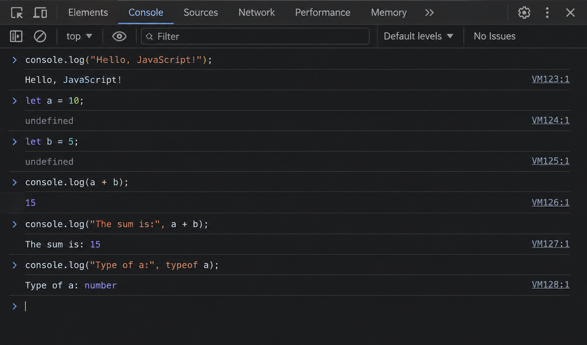
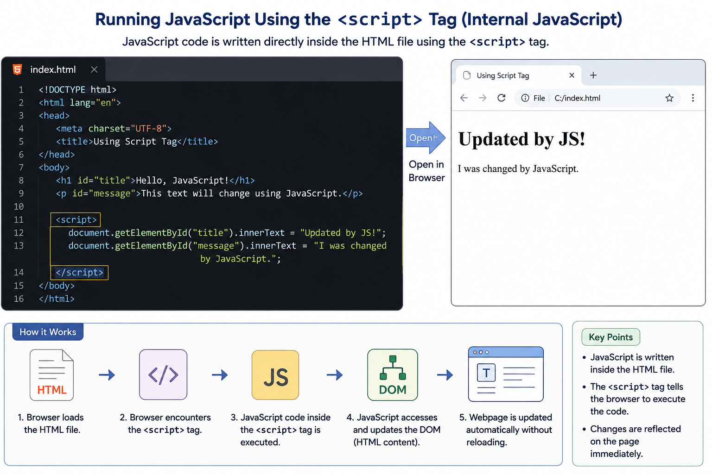
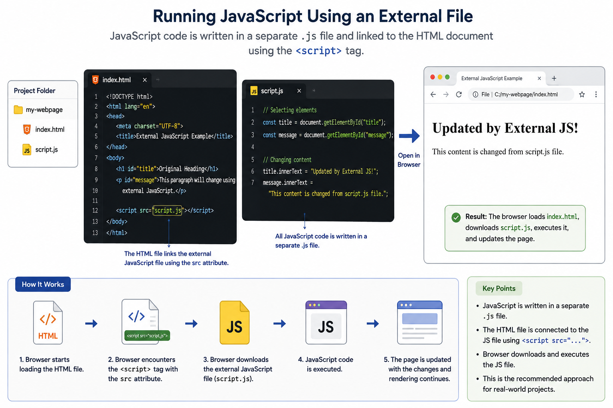

# What Do We Need to Do to Run JavaScript?

Before we can write programs or build interactive web pages, we must first understand how JavaScript is executed. Unlike HTML and CSS, JavaScript does not run automatically simply because it is written. It needs an environment that can read, interpret, and execute the code.

For beginners, the easiest environment is a web browser. Every modern browser contains a built-in JavaScript engine that is responsible for executing JavaScript code. Depending on the purpose, JavaScript can be executed in different ways during development.

The three primary ways to run JavaScript are:

*   **Using the Browser Console (Developer Tools)**
*   **Writing JavaScript inside the `<script>` tag**
*   **Loading JavaScript from an external `.js` file**

Although each method executes JavaScript, they are used in different situations. Let us understand each of them.

## 1. Running JavaScript Using the Browser Console

The Browser Console is the quickest way to execute JavaScript without creating any files. It is a built-in feature available in every modern web browser through the Developer Tools.

Developers often use the console to experiment with small pieces of code, test JavaScript expressions, and debug programs during development.

Since the code is executed immediately, it is an excellent environment for learning and understanding how JavaScript behaves.

## 2. Running JavaScript Using the `<script>` Tag

Another way to run JavaScript is by writing it directly inside an HTML document using the `<script>` tag.

The `<script>` tag acts as a bridge between HTML and JavaScript. When the browser encounters this tag while loading a webpage, it recognizes that the enclosed content is JavaScript code and executes it.

This approach is known as **Internal JavaScript** because the JavaScript code is written inside the same HTML file.

It is commonly used for learning basic concepts, creating small examples, or testing simple functionality.

## 3. Running JavaScript Using an External File

As applications become larger, writing all the JavaScript inside the HTML file becomes difficult to manage. In such cases, JavaScript is written in a separate file with a `.js` extension.

The external file is then connected to the HTML document using the `src` attribute of the `<script>` tag.

When the browser loads the webpage, it downloads the external JavaScript file, executes its contents, and then continues rendering the rest of the page.

This approach is called **External JavaScript** and is the preferred method in modern web development because it improves code organization, readability, reusability, and maintainability.

## Summary

Each of these methods allows JavaScript to be executed, but they serve different purposes:

*   **Browser Console** – Best for quick testing, experimentation, and debugging.
*   **`<script>` Tag (Internal JavaScript)** – Suitable for learning concepts and creating small examples.
*   **External JavaScript File** – Recommended for real-world applications because it keeps code organized, reusable, and easier to maintain.

In the following sections, we will explore each of these methods in detail and learn how to use them effectively while building JavaScript applications.

## Live Environment Playground

You can run checking expressions in the editor below. The browser environment executes the script wrapper immediately:

 Tag&quot;;\nconst method3 = &quot;External .js File&quot;;\n\nconsole.log(`3 Ways to Run JS: ${method1}, ${method2}, and ${method3}`);">
    

        
Snippet Sandbox: Execution Methods

    

    <textarea class="sandbox-editor" spellcheck="false"></textarea>
    

        <button class="btn btn-secondary btn-reset">Reset</button>
        <button class="btn btn-primary btn-run">Run Code</button>
    

    
Console empty...

