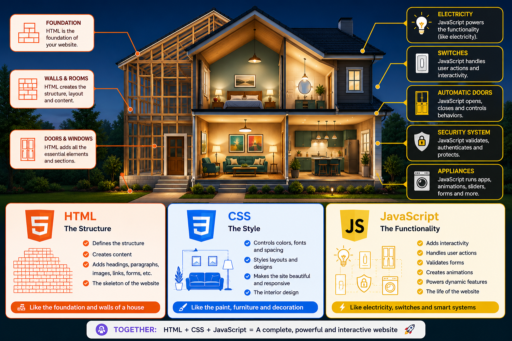

# What is JavaScript?

JavaScript is one of the most popular and widely used programming languages for web development. It is responsible for adding **logic, behavior, and interactivity** to websites, transforming them from static pages into dynamic and engaging web applications.

You may often hear JavaScript referred to as both a **programming language** and a **scripting language**. While both terms are commonly used, in modern web development JavaScript is generally considered a **high-level programming language** that runs directly inside web browsers as well as on servers (using environments like Node.js).

## JavaScript in the Web Stack

Modern websites are built using three core technologies, each serving a specific purpose:

*   **HTML (HyperText Markup Language)** provides the **structure** of a webpage. It defines elements such as headings, paragraphs, images, buttons, forms, and links.
*   **CSS (Cascading Style Sheets)** controls the **appearance and layout** of those elements by adding colors, fonts, spacing, animations, and responsive designs.
*   **JavaScript** brings the webpage to **life** by adding **behavior, logic, and interactivity**.

Think of them like building a house:

*   **HTML** is the foundation, walls, and rooms.
*   **CSS** is the paint, furniture, decorations, and interior design.
*   **JavaScript** is the electricity, switches, doors, security system, and appliances that make the house functional and interactive.

Without JavaScript, a webpage can display information, but it cannot intelligently respond to user actions.

## Why Do We Need JavaScript?

Imagine visiting a website where:

*   Every button does nothing when clicked.
*   Forms accept any incorrect information.
*   Shopping carts never update.
*   Navigation menus cannot open.
*   New messages require refreshing the entire page.

Such a website would feel slow, outdated, and frustrating to use.

JavaScript solves these problems by allowing developers to write instructions that execute when users interact with the webpage. It enables the browser to react instantly to user actions without requiring a full page reload.

This is what makes modern websites feel fast, responsive, and interactive.

## What Can JavaScript Do?

JavaScript can perform countless tasks. Some of the most common include:

*   **Respond to button clicks** by performing specific actions.
*   **Handle user interactions**, such as liking a post, submitting a comment, or adding an item to a shopping cart.
*   **Navigate users between pages** automatically after login or logout.
*   **Validate form inputs** before sending data to the server, ensuring users enter correct information.
*   **Update webpage content dynamically** without refreshing the page.
*   **Display popups, notifications, and alerts** to communicate important information.
*   **Create animations and interactive effects** that enhance the user experience.
*   **Fetch data from servers** to display the latest information, such as weather updates, stock prices, or social media posts.
*   **Build complete web applications** including dashboards, chat applications, online editors, and games.

## Real-World Examples

Think about some websites you use every day:

*   When you **like a post on Instagram or Facebook**, JavaScript updates the like count instantly.
*   When you **search on Google**, suggestions appear as you type.
*   When shopping on **Amazon**, the cart updates immediately after adding an item.
*   When watching **YouTube**, the next video loads automatically without reloading the page.
*   When filling out a registration form, JavaScript warns you if your email format is invalid before you submit it.

These smooth and interactive experiences are powered by JavaScript.

## Summary

JavaScript is the technology that makes websites **interactive, intelligent, and dynamic**. While HTML builds the structure and CSS designs the appearance, JavaScript controls how a webpage behaves and responds to users.

By combining these three technologies, developers can create modern web applications that are fast, responsive, engaging, and user-friendly.

## Live Workshop Playground

To practice, check how values output in execution. You can write custom statements on the sandbox block below:

    

        
Snippet Sandbox: Getting Started

    

    <textarea class="sandbox-editor" spellcheck="false"></textarea>
    

        <button class="btn btn-secondary btn-reset">Reset</button>
        <button class="btn btn-primary btn-run">Run Code</button>
    

    
Console empty...

