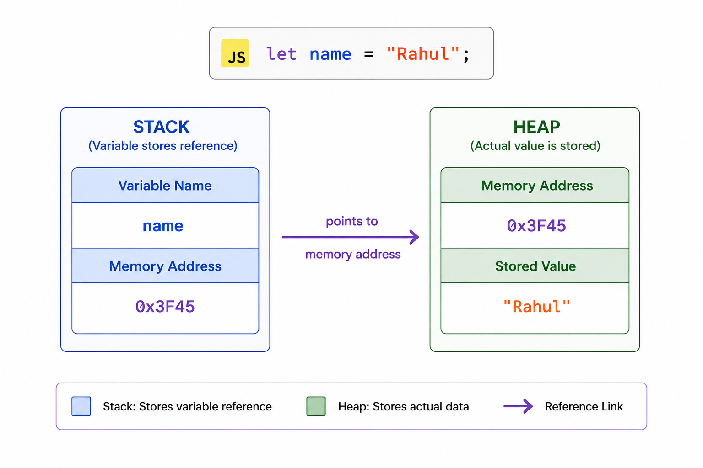

# Understanding Variables and Constants

> **Note:** Before diving into advanced features like `let` and `const` introduced in modern ES6+ (and later) versions of JavaScript, let us first build a solid foundation by understanding what variables and constants actually are.

## What is a Variable?

A **variable** is a container used to store data in a program. It allows us to save a value under a name so that we can use or modify that value later in the program.

For example:

    

        
Snippet Sandbox: Basic Variable

    

    <textarea class="sandbox-editor" spellcheck="false"></textarea>
    

        <button class="btn btn-secondary btn-reset">Reset</button>
        <button class="btn btn-primary btn-run">Run Code</button>
    

    
Console empty...

Here:
* `age` is the variable name.
* `25` is the value stored inside it.

You can think of a variable as a labeled box in memory:

`age  →  25`

Whenever we refer to `age`, JavaScript retrieves the value stored in that memory location.

Variables make programs dynamic because their values can change during execution.

> **Under the Hood (Memory Heap)**: When a variable is created (like `var name = "Rahul";`), the JavaScript engine allocates a Memory Address (e.g., `0x3F45`) in the heap and stores the value `"Rahul"`. The variable `name` is then pointed to that address so it can continually fetch the stored value.

## What is a Constant?

A **constant** is a type of container similar to a variable, but with one critical difference: once a value is assigned to a constant, **it cannot be changed or reassigned**. Constants are used for values that must remain fixed throughout the execution of a program.

For example:

    

        
Snippet Sandbox: Constant Example

    

    <textarea class="sandbox-editor" spellcheck="false"></textarea>
    

        <button class="btn btn-secondary btn-reset">Reset</button>
        <button class="btn btn-primary btn-run">Run Code</button>
    

    
Console empty...

## ES6 Variable Types

JavaScript exposes three keywords to define variables: `var`, `let`, and `const`.

*   **var:** The legacy keyword. Variables declared with `var` have functional or global scope and suffer from variable hoisting.
*   **let:** Block-scoped variable declaration. The variable can be reassigned freely.
*   **const:** Block-scoped read-only constants. They cannot be reassigned once defined.

    <strong>Developer Insight:</strong> Avoid using <code>var</code>. Modern development practices dictate using <code>const</code> by default for most variables, and falling back to <code>let</code> only when you expect values to mutate.

### `var`, `let`, and `const` Comparison

| Feature | `var` | `let` | `const` |
| :--- | :--- | :--- | :--- |
| **Introduced In**| ES5 (Legacy) | ES6 (Modern) | ES6 (Modern) |
| **Scope** | Function / Global | Block | Block |
| **Reassignment** | ✅ Yes | ✅ Yes | ❌ No |
| **Redeclaration** | ✅ Yes | ❌ No | ❌ No |
| **Hoisting** | ✅ Yes (Initialized as `undefined`) | ✅ Yes (But in Temporal Dead Zone) | ✅ Yes (But in Temporal Dead Zone) |

### Key Term Definitions

* **Reassignment:** The ability to give a variable a new value using the `=` operator after it has already been given a value.
* **Redeclaration:** The ability to create a variable with the exact same name again in the same scope using `var`, `let`, or `const`.
* **Hoisting:** JavaScript's default behavior of moving variable declarations up to the top of their scope before the code is executed.

## Naming Rules and Best Practices

When declaring variables, certain rules must be followed:

### Rules
* Names can contain letters, digits, underscores (`_`), and dollar signs (`$`).
* Names cannot start with a number.
* Names are case-sensitive.
* Reserved keywords (like `let`, `const`, `if`) cannot be used.

### Best Practices
* Use meaningful names (e.g., `totalPrice` instead of `tp`).
* Follow `camelCase` naming convention (for e.g. `firstName`, `lastName`).
* Use `const` by default, and `let` only when reassignment is needed.
* Avoid using `var` in modern development.

> **Note:** The concepts of hoisting, temporal dead zone, and block scope will be explored in the upcoming section of Advanced JavaScript.
