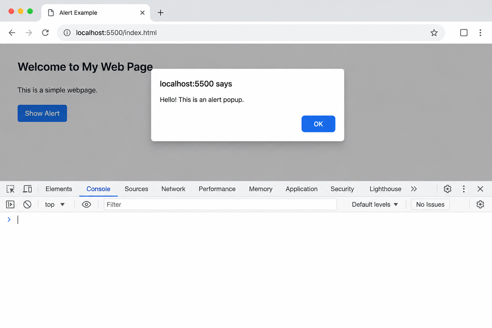

# alert()

The `alert()` function is an extremely simple built-in command that creates a graphical pop-up window right on the user's screen. 

*alert("Warning: Your checkout failed!");*

### 1. It belongs to the Window, not the Console

Unlike `console.log()` which silently prints text into the developer tools (hidden from normal users), `alert()` is actually a built-in method belonging to the global browser interface. Its true, fully-technical name is actually `window.alert()`! 

Because it natively belongs to the `window` object, it creates a literal graphical pop-up window directly in the middle of the screen that visually forces the user to interact with it.

### 2. The Big Problem: It Freezes Everything

Historically, `alert()` was heavily used to show important warnings or errors to users (like "Please enter a valid email"). 

However, today it is highly discouraged in professional websites because it is a **blocking method**. When an alert pops up:
* It completely freezes all JavaScript execution on the entire page.
* The user cannot scroll, type, or interact with anything else on the webpage.
* Everything is entirely stuck until they finally click the "OK" button!

### 3. What do Professionals Use Instead?

Because `alert()` is incredibly disruptive and completely breaks the flow of a website, modern developers now handle warnings differently:

* **For Developers (Debugging):** We use `console.warn()` or `console.error()`. This strictly drops the warning quietly in the developer tools without freezing the user's screen.
* **For regular Users (UX):** We build custom, beautiful UI elements (often called "Toasts", "Banners", or "Modals"). These are those sleek, non-blocking error boxes you see slide in at the corner of modern apps!

> **Simple idea:** Today, `alert()` is mostly just used by beginners getting started with JavaScript as a super fast way to test if code is working without needing to even open up the developer console!

---

### 🧪 Alert Sandbox

Trigger an alert natively right inside the browser window! Notice how you absolutely cannot click anything else on the underlying page while it's open!

    

        
Snippet Sandbox: Popping an Alert

    

    <textarea class="sandbox-editor" spellcheck="false"></textarea>
    

        <button class="btn btn-secondary btn-reset">Reset</button>
        <button class="btn btn-primary btn-run">Run Code</button>
    

    
Console empty...

