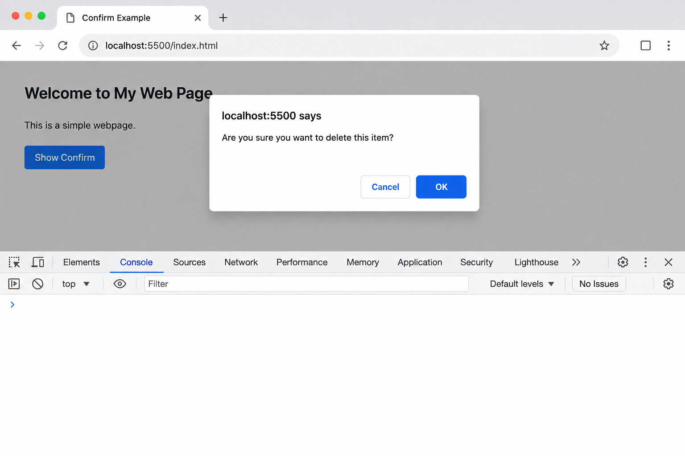

# confirm()

While `alert()` simply shows a warning, and `prompt()` gathers custom text, the `confirm()` function is specifically designed to ask the user a strict **Yes or No** question.

Just like the others, it is a method of the global browser interface (its true name is `window.confirm()`). Rather than providing a text input box, it gives the user exactly two distinct options: an "OK" button and a "Cancel" button.



### The Boolean Connection
Because it is asking a strict question, `confirm()` is the perfect real-world example of a Javascript function that naturally deals with **Booleans**. 

Unlike `prompt()` which awkwardly returns a text string, `confirm()` directly and beautifully outputs a true boolean value:
* If the user clicks **OK**, the program instantly receives `true`.
* If the user clicks **Cancel** (or closes the pop-up), the program receives `false`.

```javascript
let deleteFile = confirm("Are you sure you want to permanently delete this file?");

// Because confirm() returns a true Boolean, you can plug it straight into an IF statement!
if (deleteFile) {
    console.log("File deleted successfully.");  // Runs if true (User clicked OK)
} else {
    console.log("Deletion canceled."); // Runs if false (User clicked Cancel)
}
```

### The Freezing Problem
Once again, `confirm()` natively suffers from the same frustrating problem as all the others—it is a **blocking method**. The exact millisecond it appears on the screen, all JavaScript completely pauses and freezes until the user makes a firm choice. 

To avoid locking up the webpage, professional web developers replace this dated pop-up with custom "Confirmation Modals" built with standard HTML and styled elegantly with CSS!

---

### 🧪 Confirm Sandbox

Try prompting a strict YES or NO question and intercepting the boolean response!

<div class="integrated-sandbox" data-code="let isReady = confirm(&quot;Are you ready to intentionally launch the rocket?!&quot;);\n\nif (isReady) {\n    alert(&quot;🚀 Mission sequence engaged!&quot;);\n} else {\n    alert(&quot;Mission aborted. 🛑&quot;);\n}">
    <div class="sandbox-header">
        <div class="sandbox-title">Snippet Sandbox: True/False Checker</div>
    </div>
    <textarea class="sandbox-editor" spellcheck="false"></textarea>
    <div class="sandbox-controls">
        <button class="btn btn-secondary btn-reset">Reset</button>
        <button class="btn btn-primary btn-run">Run Code</button>
    </div>
    <div class="sandbox-output">Console empty...</div>
</div>
