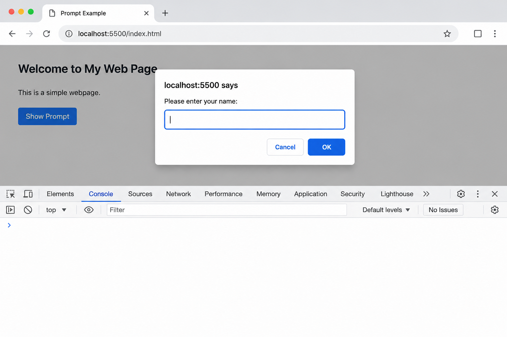

# prompt()

While `alert()` is only used to *show* you information, the `prompt()` function is famously used to formally ask the user to absolutely type in an answer. 

Just like `alert()`, it physically belongs to the global browser (its true name is `window.prompt()`). When you use it, a pop-up box appears on the exact middle of the screen with a blank text field, an "OK" button, and a "Cancel" button. 




### Why Type Conversion Matters Here!
Because `prompt()` strictly deals with text typed on a physical keyboard, it will always return a **String**—even if the user types a math number! This makes it the ultimate real-world example for why you absolutely need explicit type conversion!

```javascript
let age = prompt("What is your age?"); 
// If the user types 25, the variable holds the text string "25"

// 🚨 DANGER: This will do string concatenation!
let nextYearAge = age + 1; 
console.log(nextYearAge); // Output: "251" 

// ✅ FIX: Use Explicit Type Conversion!
let numericAge = Number(age);
let correctNextYear = numericAge + 1;
console.log(correctNextYear); // Output: 26
```

### The Freezing Problem
Just like `alert()`, `prompt()` is a terrible **blocking method**. The moment it appears on the screen, all JavaScript completely pauses and freezes until the user fills out the box or identically clicks Cancel.

Because it creates such a jarring experience, professional websites completely avoid it. Instead, they gather input by building standard HTML text boxes (`<input type="text">`) styled elegantly with full CSS!

---

### 🧪 Prompt Sandbox

Try asking yourself a question using `prompt()` and manipulating the string answer it returns back!

<div class="integrated-sandbox" data-code="let snack = prompt(&quot;What is your favorite snack?&quot;);\n\nif (snack) {\n    alert(&quot;Awesome! I love &quot; + snack + &quot; too!&quot;);\n} else {\n    alert(&quot;You didn't type anything!&quot;);\n}">
    <div class="sandbox-header">
        <div class="sandbox-title">Snippet Sandbox: Gathering Input</div>
    </div>
    <textarea class="sandbox-editor" spellcheck="false"></textarea>
    <div class="sandbox-controls">
        <button class="btn btn-secondary btn-reset">Reset</button>
        <button class="btn btn-primary btn-run">Run Code</button>
    </div>
    <div class="sandbox-output">Console empty...</div>
</div>
